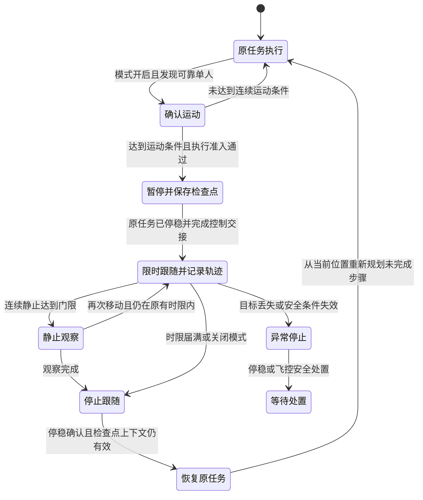

# 任务内临时人物跟随与轨迹记录

2026-10-31。目标：操作者在 UI 开启人物跟踪模式后，执行任务时自动发现可靠的移动人体，限时插入跟随，记录人物运动轨迹并叠加到地图／RViz；人物持续静止后观察一段时间，再继续原任务。

## 目标任务流程

UI 开关是一轮任务期间的模式授权，开启后不再要求每次点击人物。首版只允许唯一、可靠、三维可定位的人体自动触发；出现多人或关联不明确时不自动选择最近的人。人工选框预演仍可独立使用。

只在正常 NAVIGATE／PLAN_REQUEST／HOVER 阶段考虑插入，不打断起飞、初始化扫描 OBSERVE、返航或降落。返航、降落、人工接管和飞控 failsafe 优先。尚未真正进入可暂停任务阶段时，模式保持等待而不创建飞行任务。

## 初始条件与时限

| 配置 | 当前自动记录／预演初值 | 说明 |
| --- | ---: | --- |
| 运动确认窗口 | 1.5 s | 按采集时间统计，至少 5 个有效样本 |
| 运动速度／位移 | >0.2 m/s 且 ≥0.3 m | 使用地图水平位移；仍需观测误差标定 |
| 静止速度 | <0.08 m/s | 与运动门限之间保留滞回 |
| 连续静止确认 | 2 s | 非静止样本会清除本轮静止计时 |
| 静止后观察 | 3 s | 再次移动则重置观察，不重置总时限 |
| 一轮总活动时限 | 10 s | 当前包含跟踪和静止观察，届满优先结束 |
| 冷却 | 15 s | 防止对同一人物连续打断任务 |
| 最大连续观测间隔 | 0.5 s | 超过后清除运动确认窗口 |
| 显示历史 | 16 段，每段最多 1000 点 | 已完成记录另追加 JSONL，避免显示限额删除持久记录 |

所有数值为受控仿真的初始配置，集中在 `EpisodeConfig` 中，不是已冻结的飞行安全参数。速度来自可见躯干表面观测，不等同人体中心速度。以相同采集时间重发不能延长确认或增加轨迹点；相同采集时间的位置冲突则失效。

“保持期望距离”与“人物在移动”是不同条件：移动确认允许插入跟随，距离和动态安全检查决定每一段是否需要移动。轨迹展示记录人物观测位置，不是飞机轨迹，也不是飞机应当直接沿着飞行的路线。

## 原任务检查点与行为树要求

现有 `ReturnCheckpoint` 专用于返航覆盖流程；`restore_original_mission()` 还要求对应的 return_override、暂停保持所有权等条件，不能直接拿来恢复一次任意人物跟随。

正式执行应增加同一根任务下的 FollowPerson 子阶段及独立中断检查点，至少保存：根 UUID、coordinator 实例、控制会话和世代、原任务配方／plan_revision、当前未完成步骤、剩余 HOVER 时间、必要的扫描锚点、Home、总任务截止时间、地图和定位／对齐身份及重置计数。暂停期不得让另一个根任务取得控制权。

行为树执行顺序应为：

1. 核对模式授权、人体连续运动、任务可插入、动态安全及总剩余预算。
2. 请求原任务暂停，等待真实停稳和保持交接；收到请求 ACK 不能开始跟随。
3. 同一根任务内进入 FOLLOW_PERSON，以既有规划／执行器发出短段目标，持续检查进展租约和动态安全。
4. 静止确认、观察完成、时限或关闭模式后，撤销跟随并确认停稳。
5. 检查原 root、检查点、地图／定位上下文及截止时间；从当前位置创建新轨迹，继续未完成步骤。不得重放旧轨迹、重新起飞或延长原总任务预算。

人物丢失不是静止。发生丢失、身份歧义、定位失效、停稳未确认时走独立异常停止；首版不自动换人或把故障当作正常观察完成。人工接管立即结束自动输出，不再主动恢复原任务。

## 本轮已实现与执行边界

已实现 UI 的“人物跟踪模式（预演）”开关、任务身份筛选、无需选框的单人运动确认、自动记录／限时／静止观察／冷却状态机、轨迹持久化，以及地图坐标系下的 RViz 轨迹图层。

当前状态名使用 `SHADOW_FOLLOW`、`SHADOW_OBSERVE`，且输出 `mission_interrupted=false`、`execution_ready=false`。原任务实际继续运行；本轮不调用任务 PAUSE／RESUME，不保存可供执行器恢复的检查点，也不向 PX4 发跟随目标。档案中的 mission 字段是根任务身份记录，不是物理恢复授权。

完整飞行流程仍缺少动态安全监视、同根任务内 FOLLOW_PERSON 执行阶段及行为树控制交接。这些完成前，EXECUTE 保持拒绝。不能以模式开启、影子状态转换或 RViz 轨迹显示，声称飞机已经跟随并恢复任务。

## 界面、话题与文件

- `/uav/people/follow/auto_mode`：SetBool，开启／关闭自动记录与预演，默认关闭。
- `/uav/people/follow/status`：包含 automatic 配置、阶段、原因、目标、当前段、记录错误及执行边界。
- `/uav/people/motion_trajectories`：可靠 Transient Local MarkerArray，人物运动折线和标签，可与实时地图叠加；RViz 重连可收到最近快照。
- `/uav/people/motion_path`：最近一段处于当前地图上下文的 Path；切换地图上下文时不把旧轨迹画入新地图。
- 当前运行目录的 `person-motion-trajectories.json`：周期性原子保存最近显示历史及活动段。
- 同目录 `person-motion-trajectories.jsonl`：按段追加已完成轨迹，保留结束原因、采集时间、地图／定位身份、人物临时 ID 和原任务身份。

地图中的人物轨迹是独立显示层，不写入 ESDF／占用地图，不作为动态避障资格。记录点语义保留为 `visible_torso_surface`。原始位置、时间及上下文保留，不能称为人体真值或实机精度。

关闭模式终止当前影子记录，保留已有轨迹；后端重启默认关闭模式，不恢复自动执行授权。新日志路径必须尚不存在，避免覆盖原记录。若磁盘记录失败，状态中明确报告，不伪称保存成功。

验证记录见[自动人物记录与跟随影子流程验证](../validation/simulation/2026-10-31-person-follow-auto/REPORT.md)。
