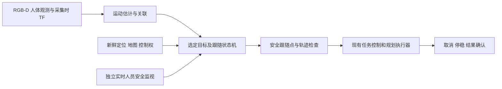

# 移动人体主动跟踪实现方案

状态：2026-10-31 已实现人工选框预演，以及任务内自动运动确认、轨迹记录和 RViz 显示的影子流程；飞行执行与验收尚未完成。当前目标是 UI 开启人物跟踪模式后，在原任务中自动发现可靠移动人物、限时跟随、静止观察后恢复任务。实际暂停／飞行／恢复仍待动态安全和 PX4 行为树执行接入，检测到运动不触发起飞或解锁。

## 现有基础与缺口

- [人体感知](../../src/uav_target_perception/README.md)输出 `/uav/people/observations`：地图坐标、每次观测采集时间、地图和定位上下文、检测分数及深度支持。点的语义是可见躯干表面，不是人体中心或脚的位置；`depth_spread_m` 也不是位置协方差。
- 现有 `track_id` 是临时空间关联编号，历史标记是展示层，均不能证明跨遮挡身份连续，更不能当成实时目标。当前主要证据为静态人体仿真，动态、多人和实机仍待验证。
- [导航 Action](../navigation/NAVIGATION_ACTION.md)提供目标、UUID 取消及停稳确认，但文档中的算法执行器不连接 PX4。全链路的任务控制、规划和避障接口需要单独核对和适配，不能直接假定此 Action 可驱动 PX4。
- 现有静态地图及 ESDF 不保证动态障碍的时效性，也不证明对人的实时避碰。启动定位和地图准入通过只说明启动条件满足，不等于跟随飞行安全。

## 总体设计

1. **观测与运动估计**：消费实时 observation，按 `last_observed` 排序；只接受有效、时间推进、历史 TF 和当前地图／定位／对齐身份一致的观测。对候选轨迹进行门控关联和有界速度估计，利用多帧位移、时间跨度、定位误差预算和滞回区分静止与运动。机体运动造成的视角、躯干表面和遮挡变化也会改变观测点，不能简单以两帧差值判定人在移动；定位漂移、深度异常、时间回退或关联不确定时输出 UNKNOWN，禁止开始或继续移动。速度及不确定度须由数据验证，不从深度 spread 冒充协方差。
2. **目标选择**：首版仅支持场景内单人；人工预演由操作者选定候选，任务内自动模式在 UI 开启后确认唯一可靠的移动目标；多人、交叉、遮挡后身份歧义立即停止并要求重新选择，不按最近人自动换目标，不把 ID 当作真实身份。持续跟随期间可处理目标停下：停在安全距离、维持观察；若观测丢失则停止，不盲目追至最后位置。
3. **跟随点**：在地图水平面，从人体估计位置沿“人体到飞机”方向选择保持距离的点，高度维持已批准的安全飞行高度，偏航控制仅在实际执行器支持且独立验证后启用。不能把观测表面位置当作人体中心：安全计算需加入人体占用范围、表面偏差和观测误差。目标过近时停止，不自动向未知空间后退；目标过远、超速、不可见或候选点不可达时停止并报告。
4. **分段执行**：首期每段只在已观测自由空间内提交短目标，目标变化达到阈值且经过最小间隔才重新规划；没有安全候选点就保持。须复用既有任务所有权、地图会话、轨迹完整检查和单一控制输出，禁止绕过执行器直接发送 PX4 setpoint。更换目标时撤销旧 UUID、等待实际停稳和清理确认，再检查当前上下文与目标后提交下一段；取消 ACK 不代表停稳。停稳无法确认时锁定新任务并上报。
5. **动态安全监视是飞行前置条件**：独立于跟随目标规划，覆盖选定人员及其他可探测人员，在整条轨迹和制动过程上检查时变膨胀占用、最近距离及传感器覆盖。考虑观测年龄、端到端延迟、人体可能速度、飞机制动距离、机体尺寸、定位／深度误差及盲区；无法给出保守界、传感器失效或人员可能进入制动区域时立即撤销并执行已有安全停机流程。只依靠旧 ESDF、目标点净空或单个人体中心点不足以放行。此监视尚不存在，完成并通过验证前禁止动态人体跟随飞行。

## 状态与控制权

下表保留人工跟随流程设计；任务内自动插入的状态与当前影子实现以[任务内跟随设计](MISSION_PERSON_FOLLOWING.md)为准。

| 状态 | 进入条件与行为 | 退出条件 |
| --- | --- | --- |
| DISABLED | 默认关闭，不占用控制权 | 操作者请求并通过系统准备检查 |
| ACQUIRE | 只读观测，确认单人、运动和上下文连续；显示候选 | 明确选定且所有准入通过，进入 READY；否则保持或取消 |
| READY | 显示目标、距离及拒绝原因；不自动解锁 | 操作者明确启动且获得任务控制权，进入 FOLLOW |
| FOLLOW | 连续监督目标、轨迹和所有安全条件；有安全点时分段执行 | 目标静止或距离满足进入 HOLD；丢失、歧义、碰撞风险或故障进入 STOPPING |
| HOLD | 保持受控位置并继续监视；不占用过期轨迹 | 新鲜目标和全部准入恢复后，按任务授权策略继续；失效进入 STOPPING |
| STOPPING | 撤销当前目标，等待停稳及控制清理确认 | 确认后进入 LOST 或结束；未确认进入 FAULT 并锁定 |
| LOST / FAULT | 显示原因；禁止自动换人、自动恢复或重放旧目标 | 人工排除原因、重新选定并显式启动 |

人工接管、控制权变化或飞控模式丢失立即终止跟随，不重新抢占；定位、地图、对齐、时钟和源重置使旧观测及目标失效。飞机失去可用悬停能力时，交给已有飞控安全机制，不能承诺软件一定能悬停。跟随与现有任务互斥，结束或取消必须经现有所有权协议；返航、降落及人工接管优先级沿用既有系统。

## 接口和参数建议

- 新增独立运动跟踪输出，包含源采集时间、发布时刻、地图／定位／对齐上下文、临时轨迹 ID、位置语义、速度、质量状态、关联歧义和失效原因；每次消费时检查源时间及接收时间，禁止重复或重放刷新有效期。保留原 observation 契约和历史层。
- 新增跟随任务入口和状态反馈：目标选择、控制会话、地图会话、状态、当前距离、目标年龄、拒绝／停止原因、当前导航 UUID 和清理确认。实际消息类型及接入点在实现前核对现有 BT/MissionServer 的控制租约和 PX4 链路，禁止创建第二个控制发布者。
- 初始仿真试验值可使用水平期望距离 3 m、跟随速度上限 0.3 m/s、单段上限 0.5 m；这些只是调试起点，不是安全距离或验收结论。最小安全距离须大于人体及机体膨胀半径、误差、延迟内相对位移和实测制动距离之和，并有额外裕量；若大于期望距离，则增大期望距离或拒绝启动。运动阈值、观测超时、更新间隔、加速度及保持高度须经采样率、误检和制动实测确定，缺少标定值时保持禁用。
- 在公共 `scripts/sim.sh run full` 及现有 profile/JSON 注册机制增加显式实验选项；默认关闭跟随和移动人体场景。新建可重复的行人轨迹、真值日志及碰撞几何，真值仅用于测试评估，不输入感知或控制。人员检测现有默认值不因本方案改变。

## 实施和验收阶段

1. **离线及只读感知**：重放静止人、移动人、相机／飞机运动、遮挡、丢帧、多人交叉和上下文重置；评估运动误报漏报、速度误差、延迟和 ID 切换。统计指标的时间基准、样本、距离、速度及真值误差须记录，阈值在飞行前根据结果冻结。此阶段无控制输出。
2. **动态安全模块**：在静态及移动障碍场景验证时间膨胀、盲区、延迟和制动包络，注入检测失效、突然接近、其他人进入和传感器冻结。逐项证明撤销至停稳的最坏情况，覆盖接管及停稳失败；无法保证包络时拒绝跟随。
3. **算法级分段跟随**：先用现有不接 PX4 的受管算法执行器验证所有权、短目标、取消／停稳、目标丢失及障碍拒绝；记录真值距离、轨迹、状态和事件，不据此声称 PX4 飞行通过。
4. **Gazebo/PX4 SITL**：先静止目标，再单人低速直线、停走、转向、短遮挡、突然接近、不可达和丢失；分别验证人在轨迹外进入、机体盲区和故障。每次记录地图身份、原始观测、真值、速度、最近人体表面至机体净距、控制租约、取消到停稳时间及碰撞；真实净距在完整制动期始终不低于事先冻结的安全界，任何碰撞、误换人、失控或未确认停稳均失败。验证清理及不自动解锁／恢复。
5. **硬件准备和实飞**：独立验证 OAK-D 注册深度、时间同步、视野、机载算力和端到端延迟，再做无桨或约束台架、受控空场分级测试；制定现场隔离和人工接管流程。只有相应阶段通过后才讨论进一步部署，仿真结果不等于真实人体附近飞行许可。

## 交付与决策

建议按“只读运动估计 → 动态安全监视 → 算法执行 → PX4 SITL → 硬件”分批实现和提交，每一阶段保留配置、测试报告与原始证据。首期以单人、明确选择、低速、已知可观测空间为范围；持续移动中平滑轨迹接续、多人身份重识别和复杂拥挤场景留待后续单独设计。

## 2026-10-31 首批接入

已实现 `person_follow_backend.py` 与非阻塞界面客户端。后端校验选框源帧、真实检测框、单人三维观测、历史相机投影、地图／定位身份和新鲜里程计，绑定临时空间 track ID；UI 选择编号与三维 track ID 分开。开始、暂停、继续和取消通过独立 SetMissionIntent 服务传输，绑定后端实例与会话 UUID，并对请求 UUID 做幂等处理。清除选择、窗口关闭、心跳超时或观测失效会终止预演。

当前状态为 `PREVIEW_ONLY`：候选点保持当前高度、期望水平距离 3 m、单次位移不超过 0.5 m；过近不自动后退。速度和运动判断仅为未标定的观测估计，躯干表面误差仍存在。UI 显示候选点及实际阻断原因，未向规划器或 PX4 发出目标。

本批未实现动态安全监视、算法导航执行适配或 PX4 `FOLLOW_PERSON` 行为树步骤；`EXECUTE` 明确拒绝并报告这两项飞行阻断。现有航点任务和跟随预演不会争抢飞行控制权，预演停止不代表飞机停稳。完整说明见[视觉监控界面](../simulation/VISION_MONITOR.md)。

现有链路梳理、已复现问题与修复优先级见[2026-10-31 跟随诊断报告](../validation/simulation/2026-10-31-person-follow-audit/REPORT.md)。报告为代码审查与隔离测试，不代表飞行验收。

## 任务内自动插入需求（2026-10-31）

后续目标改为 UI 开启模式后，在原任务执行期间自动发现移动人物，限时跟随、记录轨迹、静止观察后续跑原任务。具体状态、初值、检查点和本轮影子实现边界见[任务内临时人物跟随与轨迹记录](MISSION_PERSON_FOLLOWING.md)。该新需求替代首期“每次都由操作者选人”的自动流程设计；人工选框预演入口继续可用。
