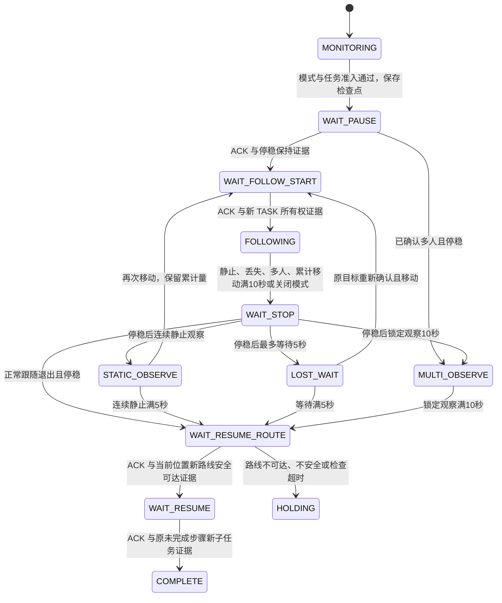

# 人物跟随任务中断协调协议

2026-11-07。目标流程：保留原任务已完成进度，在同一根任务内插入人物跟随；退出后从当前位置重新规划到当前未完成步骤的原目标，继续该步骤。不得从第一步重跑，也不得重放中断前的旧轨迹。

当前只有影子记录与纯 Python 协议模型。ROS 观察节点只调用协调器的只读就绪检查，显示 BLOCKED；缺少真实跟随执行器、动态安全资格、权威检查点及恢复路线提供者。Operation 是待适配的操作对象，没有被发送到行为树或 PX4。不能将模型测试解释为飞机已暂停、跟随或恢复。

## 已确认的退出规则

| 情况 | 行为与计时 |
| --- | --- |
| 单人移动 | 有效移动跟踪时间累计满 10 秒退出；静止、制动、丢失与重新确认期间不计入，中途停顿不清零 |
| 人物静止 | 先停止跟随，取得停稳保持证据后，连续观察静止满 5 秒退出；再次移动会重置连续静止计时，保留移动累计量 |
| 目标丢失 | 先停止跟随并安全保持，再清空运动估计窗口；最长等待 5 秒，重复丢失通知不延长等待；只允许可靠重新确认原目标 |
| 丢失后重新确认 | 5 秒内可重新建立原目标运动窗口，保留累计移动时间；超时先检查原任务路线，再继续任务。其他临时 ID 不自动视为原人物 |
| 可靠多人 | 先停止跟随并停稳，锁定原地观察 10 秒；人数降为一人、人物移动或再次出现多人都不会重新追人或重置计时 |
| 正常退出 | 先撤销跟随并确认停稳，再检查原任务目标安全可达，从当前位置生成新路线，随后继续当前未完成步骤 |
| 安全、控制或上下文故障 | 停止／保持或由执行端安全处置，不能把故障伪装成正常退出后自动恢复 |

影子记录没有物理停稳证据，只按观测接收时间模拟静止／丢失／多人阶段；正式协议的保持计时从停稳交接证据通过时开始。静止观察同时需要新的连续采集证据，重复发布同一帧不能累计时间。累计移动量取连续 MOVING 样本的采集与接收时间增量较小值，最大采样间隔 0.5 秒；运动确认窗口不倒算为已经执行的跟踪时间。

多人确认使用置信度至少 0.5 的人体框，过滤无效框，对缺少不同可靠 ID 的近乎相同框按 IoU ≥0.95 去重，再由至少 3 个新采集帧连续确认 0.5 秒。不同非空检测 ID 的重叠框保守保留；没有跨遮挡身份保证。确认窗口中存在多人歧义时，影子策略先进入丢失／安全观察，不追逐任一候选。正式运输层必须提供同等可靠的确认结果，不能直接以任意框数量触发控制。

## 行为树与操作顺序

协调器位于 `scripts/simulation/vio/runtime/mission_person_intervention.py`，共用 `person_follow_exit_rules.py` 计时内核，没有 ROS 或飞行输出。未来行为树适配器在中断点冻结步骤索引和已完成集合，停止旧执行租约，进入人物子阶段；恢复时仅为当前未完成步骤创建新 child。不能把普通 PAUSE／RESUME 服务转发当成已经完成恢复规划。

## 检查点与证明对象

| 对象 | 必须验证 |
| --- | --- |
| MissionCheckpoint | 根 UUID、coordinator、控制会话／世代、plan_revision、原 child、当前步骤索引、明确 NAVIGATE 或 HOVER 类型、原目标 map 坐标、上下文、原总截止时间和剩余 HOVER 时间 |
| ExecutorCapability | 唯一实例、原根与上下文、新鲜接收时间；跟随支持、动态安全、检查点就绪都明确成立 |
| Operation | 独立请求 UUID、同一中断 UUID、根／会话／世代；期限不超过原任务截止时间 |
| HandoffProof | 当前请求、原身份、新世代、实际 stopped／hold_confirmed、HOLD_CONTROLLER 所有权；证据新鲜且不早于请求 |
| FollowStartProof | 当前 START_FOLLOW 请求、原目标、新 TASK 所有权及推进后的世代 |
| ResumeRouteProof | 当前 CHECK_RESUME_ROUTE 请求、原身份／当前步骤／原目标、最新路线安全且可达、明确从当前位置重新规划 |
| ResumeProof | 当前 RESUME、新 TASK 世代和新 child；同一原步骤、类型、目标和截止时间；剩余 HOVER 时间不能增加 |

ACK 不能替代证明。ACK 与证明允许异步先后到达，仍须在操作期限内且证明新鲜；旧根、旧请求、旧世代、改目标和超期回复不能推进状态。

当前检查点类只是最小协调凭证，完整配方、已完成进度、Home、定位重置快照及恢复数据仍须由原执行端权威保存。已有返航专用 ReturnCheckpoint 不能直接替代。路线证明需要实际规划器验证当前位置、地图版本与动态安全；当前布尔证明仅用于合成协议测试，尚无真实提供者。

所有单调时间来自同一协调进程。跨进程适配须验证源时间与身份，并转换为本进程接收时间。stopped／hold_confirmed 不能由 UI 自设为真；正式 5 秒／10 秒保持计时须以真实停止证据为起点。

## 故障与持久化边界

- 缺任一资格不提出 PAUSE；暂停后资格失效，保持并通过路线检查才考虑恢复。
- 关闭模式时先处理已经发出的暂停／跟随交接，再走停止和路线检查；不能假定飞机尚未暂停。
- STOP_FOLLOW 必须按中断 UUID 撤销活动和迟到的 START；运输层停止／超时后拒绝旧 START。
- 人工接管、原根或地图／定位上下文改变后不自动恢复。执行端须独立撤销输出或使租约失效。
- 操作有独立确认期限并受原总任务截止时间限制。开始前预算检查只作必要门槛；重复静止与重新确认可能使本轮变长，原截止时间仍然有效，不能借恢复延期。
- 影子轨迹在丢失后分段，RViz 使用 LINE_LIST，Path 只发布最近连续段，不跨丢失区间画虚构连线。JSON schema=2 保留 segment 和各独立计时量。
- 自动授权绑定任务身份与地图上下文，变化后需重新开启。JSON／JSONL 只记录观测，不能作为真实控制或恢复凭证。

## 当前接入范围与后续步骤

UI 显示影子阶段和四个计时量；原任务实际继续运行。观察节点没有调用 begin()，不会发出暂停、跟随、停止或恢复操作。协议测试使用合成检查点和证明，不证明物理停稳或实际路线可达。

后续依次实现：权威检查点及完成进度接口 → 同根跟随执行器与动态安全监视 → 当前位置恢复规划与证据提供者 → ROS／行为树运输适配 → Gazebo/PX4 制动与恢复联调。通过这些验证前维持 PREVIEW_ONLY／SHADOW_ONLY。
