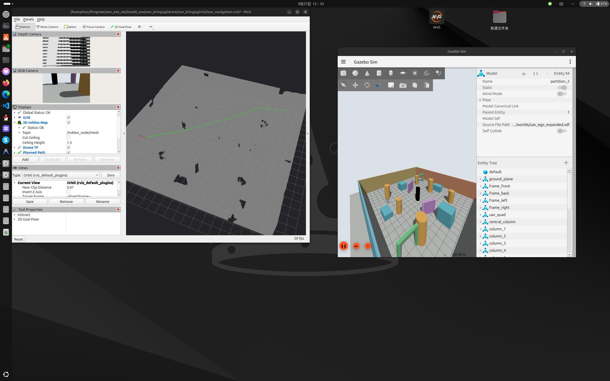
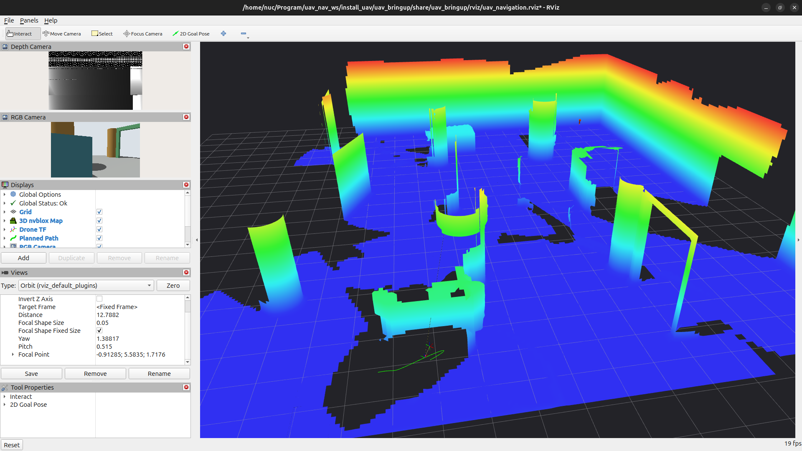
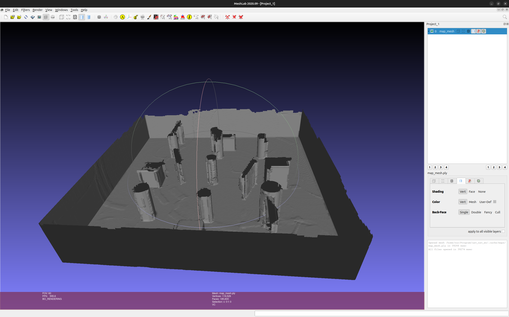
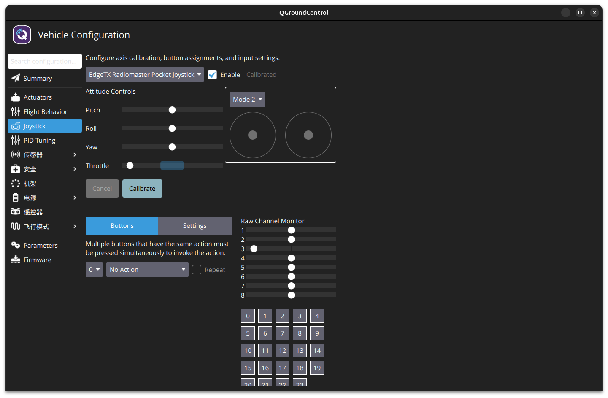
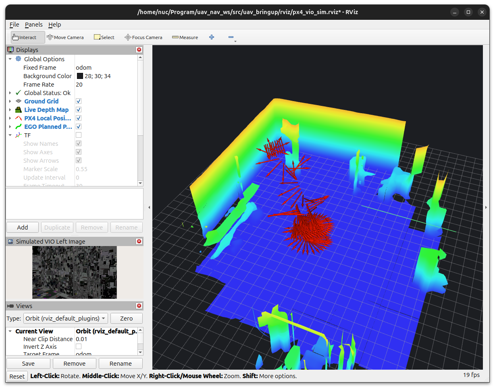
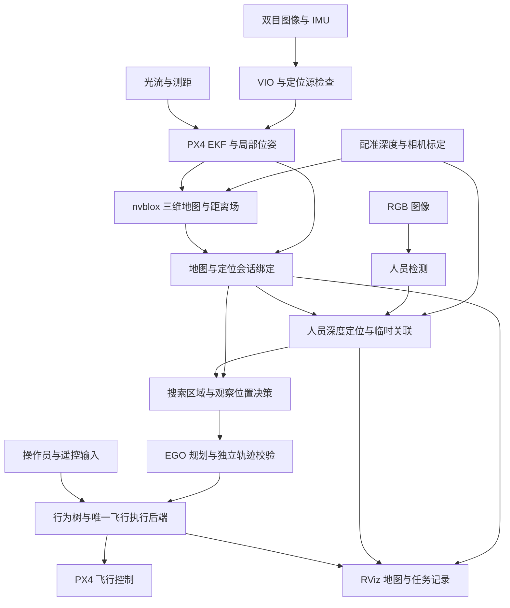

# “破晓先锋”项目书

## 面向震后坍塌受限空间的微型无人机自主探索与人员搜寻系统

| 项目要素 | 内容 |
| --- | --- |
| 项目简称 | 破晓先锋 |
| 应用方向 | 灾害应急、坍塌建筑内部侦察与辅助人员搜寻 |
| 技术方向 | 无 GNSS 定位、三维建图、自主探索、轨迹规划、端侧人员检测与空间标注 |
| 现有基础 | `uav_nav_ws`：ROS 2、cuVSLAM、nvblox、EGO Planner、BehaviorTree.CPP、PX4 |
| 拟用载体 | 7 寸级旋翼平台；整机外廓、护桨、载荷与续航需完成工程核定 |
| 研发路径 | 本机仿真与算法验证 → 传感器及飞控台架 → 受控场地飞行 → 机载部署与场景试验 |
| 编写日期 | 2026 年 10 月 23 日 |
| 现有基础复核 | 2026 年 10 月 25 日；研发目标与验收指标仍为建议值 |
| 文档用途 | 技术立项、研发规划与项目交流 |

本文依据当前工作区源码、模块说明及开发日志编制。现有成果按其原验证环境表述；拟研发功能、建议指标和估算周期单独列出。有关历史实验的描述来自既有记录，本次编写没有重新执行飞行验证。

## 一、项目摘要

“破晓先锋”面向地震、局部建筑坍塌后人员难以进入的室内空洞和受限通道，研究由微型旋翼无人机执行环境侦察、空间重建与疑似被困人员搜寻的方法。项目拟利用双目视觉、IMU、光流和测距信息，在无 GNSS 条件下建立局部定位与三维地图，通过轨迹规划和任务决策，完成有边界的区域探索、人员观测、地图标注以及返回降落。

项目以现有 `uav_nav_ws` 为研发基础：利用 cuVSLAM 提供视觉惯性定位，利用 Isaac ROS nvblox 建立三维地图和距离场，利用 EGO Planner 生成三维轨迹，由行为树编排任务，并通过唯一飞行执行后端接入 PX4。人员感知模块将 RGB 检测结果与配准深度、采集时刻的位姿结合，输出带时间和地图会话的人员空间观测。

研发重点是把“能够导航”和“能够检测人员”进一步组织成可验证的搜索流程：进入已确认可通行的区域，观察尚未覆盖的空间，发现疑似目标后选择安全观察位置进行复核，形成可供救援人员查看的地图和图像记录。首期以受控静态场景中的可见人员搜寻为目标，逐步研究弱光、部分遮挡及更复杂通道条件。

项目预期交付一套可复现的仿真系统、一个受控环境原型以及配套测试数据与报告，为后续现场应用提供技术依据。人员检测结果用于辅助搜寻，不直接判定生命体征、伤情或现场是否允许人员进入。

## 二、项目背景与需求

### 2.1 应用场景

坍塌结构内部可能存在狭窄入口、断续空洞、复杂转角及遮挡区域。操作员仅凭无人机单路图像难以持续判断周边距离、已搜索区域和返程路径。项目拟以室内救援训练场和模拟废墟为初期应用对象，形成面向以下任务的技术方案：

- **先期侦察**：从具备足够净空的入口进入，建立局部空间地图，记录可通行区域和受阻位置。
- **辅助搜寻**：在可见光成像有效的区域搜索人员，保存疑似目标的图像、局部位置与观测时间。
- **辅助研判**：在地图上呈现已观测区域、未观测区域、人员观测点及任务终止原因。
- **返回与交接**：在任务期限、定位状态及控制条件允许时返回局部起点；需要人工干预时按明确的控制权交接流程处理。

### 2.2 核心需求

| 需求 | 项目应解决的问题 |
| --- | --- |
| 无 GNSS 作业 | 依靠本地传感器定位和飞控融合，不把卫星定位作为任务成立的前提 |
| 受限空间通行 | 根据整机外廓、感知盲区、定位误差和制动空间判断通道是否可通过 |
| 未知空间探索 | 持续区分已观测自由空间、障碍与未知空间，在有限时间内选择下一观察位置 |
| 人员空间观测 | 将图像中的人员检测关联到当前地图，保留观测依据与有效期 |
| 异常处置 | 面对定位失效、地图过期、路径不可达及进程故障，执行可追踪的终止或交接流程 |
| 本地自主运行 | 核心感知与决策最终部署在机载端，任务不依赖云端推理；保留操作员监督和接管能力 |
| 结果可复核 | 交付地图、图像、时间信息、运行配置及失败记录，使现场人员能够追溯观测依据 |

## 三、项目目标与范围

### 3.1 总体目标

构建以微型旋翼平台为载体的无 GNSS 三维感知与人员搜寻原型，逐步完成“自主探索—疑似人员发现—安全观察复核—地图标注—返回降落”的任务闭环，形成可重复验证、可审计失败原因的工程系统。

### 3.2 分项目标

1. **定位与建图**：建立相机、IMU、飞控局部坐标与地图之间的一致关系，监视定位源和地图的新鲜度、重置与会话变化。
2. **通行与规划**：在已观测自由空间中生成满足机体包络和动力学约束的路径，拒绝没有足够观测或间隙的通道。
3. **探索与覆盖**：在现有算法探索能力上，开发可接入 PX4 的有界搜索任务，记录覆盖过程和剩余未知空间。
4. **人员搜寻**：利用已有人员检测与深度定位模块，开发多视角复核、观察任务及人员观测归档。
5. **任务执行**：使用行为树协调导航、观察、暂停、人工干预、返回和降落，保证任务状态与实际飞行状态一致。
6. **机载运行**：在完成本机闭环验证后，评估 Jetson Orin Nano 等候选平台的算力、内存、供电、散热和载荷可行性。

### 3.3 首期范围

首期选择结构稳定的模拟废墟、室内训练场和静态障碍场景，逐步引入弱光及部分遮挡。先验证有足够几何余量的通道，再依据测量结果缩小净空；不以高速穿缝作为首期演示目标。

“7 寸”是候选平台规格，不能直接推导整机能够通过某个人孔或缝隙。通行尺寸必须按安装护桨、相机、计算板、电池后的实际扫掠外廓核定。高推重比也不能替代对可观测性、控制误差和制动空间的验证。

首期不承诺浓烟穿透、完全遮挡人员识别、生命体征检测、危险气体检测或热源测温。气体与热源感知需要独立传感器和对应的标定、算法及验证。人员标注本身也不赋予系统动态避人能力。

## 四、现有项目基础与差距

### 4.1 已有工程基础

| 能力 | 当前基础 | 本项目需要补充的工作 |
| --- | --- | --- |
| 仿真运行 | 已有光流纯手动 `manual` 与 VIO／建图／导航 `full` 两种公共程序，均采用 PX4 SITL 动力学；新增四区障碍赛道配置与独立几何审计 | 完成赛道全程飞行验收，增加模拟废墟和光照分组，形成固定场景集 |
| 无 GNSS 定位 | 已有双目／IMU VIO、外部视觉融合与光流／测距辅助链路及源健康检查 | 补充弱纹理、遮挡、不同光照和长期运行条件下的稳定性验证 |
| 三维地图 | 已有 nvblox 建图、地图会话、地图包保存加载及网格导出 | 研究适合受限通道的地图分辨率、有效观测范围和资源上限 |
| 三维导航 | 已有 EGO 曲线规划、地图碰撞复检、轨迹采样与 PX4 执行分支 | 完成通道净空验证、探索任务接入与多场景重复测试 |
| 任务与接管 | 已有行为树、任务身份、暂停恢复、返回降落和遥控干预机制 | 开发搜索区域、人员观察和搜索终止的任务语义 |
| 人员感知 | 已有可选 RGB 人员检测、配准深度定位、临时关联、实时／历史 RViz 标注及站立、坐姿、刚体仰卧测试资产 | 验证 OAK-D RGB-D 配准、运动误差、遮挡识别、多人物和多姿态导航联合负载 |
| 运行管理 | 已有会话状态、日志、地图操作与受管进程清理 | 整理面向搜救任务的观测记录与任务摘要 |

### 4.2 已有验证的适用范围

开发日志记录了无 GNSS 仿真中的起飞、同机建图、EGO 静态绕障、到点悬停、返回、降落与上锁，以及部分虚拟遥控输入下的干预恢复实验。这些记录可以支撑继续开发搜寻任务，但不能替代实体遥控器、真实机载系统或废墟现场的验收。

人员模块已有真实图片推理、ROS 合成深度／位姿链路、固定相机的 Gazebo RGB-D 人物几何验证，以及一次含静态站立人体的完整 VIO／导航任务记录。2026-10-25 的站立、坐姿和刚体仰卧测试分别使用固定相机；组合场景生成与额外方向推理不等于多人召回率或三姿态联合飞行验收，也不证明 OAK-D 实机精度。现有输出是**可见躯干表面的代表点**，不是人体中心、脚底位置或被困人员的完整三维姿态。橙色历史点仅表示同一坐标会话中的最后观测位置，不证明目标仍在原处。

已有算法仿真包含探索相关能力；完整项目的全自主搜救流程、发现人员后自动复核的飞行闭环，以及实机搜索均需新增集成和独立验收。

详细阶段结果以[开发日志](../history/DEVELOPMENT_LOG.md)、[人员感知说明](../../src/uav_target_perception/README.md)及各轮原始报告为准。部分报告仅保存在本机，新的仓库副本可能不包含这些证据。

### 4.3 需要校正的技术表述

| 原设想 | 本项目采用的表述与依据 |
| --- | --- |
| 毫米级 ESDF 与贴壁控制 | 当前基础地图配置为 0.1 m 体素，完整 VIO 建图运行器覆盖为 0.2 m。体素大小不等于地图误差或飞控误差；缩小体素也不能直接证明毫米级控距 |
| 大视场相机提供全向避障 | 单个前向相机存在方向性和盲区。需通过转向观察、限制运动方向或补充传感器建立覆盖，实际有效视场按设备标定与当前图像配置核定 |
| 毫秒级动态避障 | 需要测量图像采集至控制响应的完整延迟，并验证运动障碍处理。单次规划耗时不能代表系统端到端响应 |
| 主动红外能够直接识别人或热源 | 主动红外在现有相机链路中用于辅助成像／深度；RGB 人员检测仍取决于输入图像，热源测量需要热成像等独立传感器 |
| Orin Nano 已可运行完整系统 | 当前以工作站开发为主，机载端尚需验证构建兼容、联合负载、内存、功耗与散热 |
| 无网等于所有链路断开也能完成任务 | 目标是核心计算不依赖外部网络或云服务；遥控、监控链路丢失后的处置需另行测试 |

地图参数依据：[基础配置](../../src/uav_bringup/config/uav_ego_nvblox.yaml)、[完整链路建图运行器](../../scripts/simulation/vio/runtime/vio_chain_mapping.py)。

### 4.4 已有测试与联调画面

以下图片选自项目历史测试截图，原文件来自 `/home/nuc/图片/截图`，已复制到文档配图目录，以相对路径引用。日期取自原文件名；图片保持原始内容，仅用于展示当时的场景、界面与可视化结果，精度、任务成功与实机能力仍以对应测试记录为准。

#### 图 1：Gazebo 场景与 RViz 地图、规划路径对照

**画面说明（2026-09-27）**：右侧为包含立柱、隔板与门框的 Gazebo 静态障碍场景；左侧为 RViz 中的地图、相机输入和绿色规划路径。该画面展示早期算法仿真的场景与规划可视化，不能单独证明 PX4 动力学执行或当前无 GNSS 链路通过验收。

#### 图 2：深度输入与 nvblox 在线三维建图

**画面说明（2026-10-06）**：左侧显示深度与 RGB 输入，右侧显示墙面、立柱和门框等结构的三维重建，以及局部绿色路径。地图采用高度颜色显示；图中空洞与缺口反映该视图中的重建覆盖情况，不能据此视为已确认的可通行区域。

#### 图 3：地图网格导出与离线查看

**画面说明（2026-10-06）**：导出的 `map_mesh.ply` 在 MeshLab 中呈现地面、墙体和障碍结构，展示三维地图成果的离线查看方式，可用于后续报告与复核。网格的外观完整度不等于几何精度，尺寸误差需另行与独立真值比较。

#### 图 4：实体 Pocket 遥控器的 QGroundControl 校准界面

**画面说明（2026-10-16）**：QGroundControl 识别 `EdgeTX Radiomaster Pocket Joystick`，界面显示启用、校准状态以及轴和原始通道读数。该图展示实体输入接入与校准界面；飞控实际接收、控制权交接和空中接管仍需对应遥测及飞行记录验证。

#### 图 5：PX4/VIO 联调中的地图与局部位姿显示

**画面说明（2026-10-22）**：RViz 以 `odom` 为固定坐标系，显示重建地图、红色局部位姿标记和仿真 VIO 左目图像；显示列表包含 EGO 规划路径项。该图用于说明定位、建图和规划的联调显示方式，红色标记不是人员检测结果，也不能仅凭界面判断轨迹已执行成功。

## 五、总体技术方案

### 5.1 系统架构

下图表示目标架构。人员驱动的观察任务、完整搜索决策及机载联合部署属于拟研发内容。

### 5.2 感知与定位

沿用双目图像与 IMU 的视觉惯性定位路线，核对时间戳、相机内参、双目外参、IMU 外参与机体安装关系。仿真与硬件分别建立参数清单，保留原始采样时间，避免用重复发布旧位姿的方式掩盖定位停更。

PX4 使用外部视觉与选定辅助源进行融合。系统需要同时判断源是否有效、样本是否新鲜、飞控是否实际融合以及估计是否健康。源重置、坐标变化和定位会话更换应使旧任务授权失效，重新建立一致关系后才能执行新任务。

无 GNSS 是受管仿真的默认条件。真值数据仅用于独立误差评估，不能回灌为实际 VIO 观测，也不能据此宣称真实传感器定位通过。

### 5.3 地图与通道可通过性

利用 nvblox 融合深度构建三维空间表达，为规划提供障碍距离与自由空间依据。保留地图标识、版本、定位会话和坐标对齐信息，使计划始终对应正确的地图。

通道准入综合考虑整机扫掠外廓、护桨、定位误差、跟踪误差、地图离散误差及制动余量。未知空间不能因为没有障碍回波就被视为自由空间；需要通过安全观察位置补充数据。对细杆、悬挂物、反光表面和低纹理区域设置专项场景，记录漏检与拒绝通行情况。

地图分辨率通过误差和资源测试选定。若现有体素不能表达目标通道，应先调整场景目标或研发更细地图及局部感知方案，不通过缩小安全包络强行放行。

### 5.4 探索与轨迹规划

将搜索区域划分为已观测空间和待观察空间，根据可达性、预期新增覆盖、返程成本及任务期限选择观察位置。首期采用有界搜索：限定区域、速度、最长任务时间和重试次数，防止不可达目标触发无限循环。

沿用 EGO 的搜索种子与 B 样条规划，并独立校验整条轨迹的碰撞、未知空间、速度、加速度及终端停止条件。优化器未收敛但使用已校验安全种子的情况需单独记录；不得将其描述为优化器成功。

新计划只有在地图、坐标、定位会话、控制权和起始状态均匹配时才能执行。规划失败时，根据飞行状态进入已验证的停止、观察、返回或终止分支；失去可靠定位时不承诺仍可定点保持。

### 5.5 人员检测与空间标注

首期复用当前 YOLOX-Tiny 人员检测首版，结合配准深度和图像采集时刻的相机到地图变换，生成带观测时间、检测分数、深度支持及地图会话的人员观测。模型选择后续根据数据集和机载性能测试调整。

当前模块使用多帧确认和有界临时关联，目标编号仅用于空间关联，不表示身份识别。地图或定位上下文失效时应清除旧实时标注，历史快照保留为历史观测，不能重新加载成当前人员位置。

拟新增的复核流程为：检测到疑似人员后，由任务层评估安全观察位置；条件满足时停稳并采集不同帧或不同视角图像，再更新观测状态。检测节点不直接发送飞控命令，所有机动通过任务和规划链路授权。复核结果表示观测证据增强，不表示确认生命状态。

### 5.6 任务决策与控制权

利用现有行为树与唯一飞行执行后端扩展搜索任务。拟设计的主要阶段为：

1. 操作员确认任务范围，完成解锁／起飞授权及状态检查。
2. 在已验证空间内进入搜索区域，建立初始地图与局部返回基准。
3. 选择观察位置，规划、移动、停稳并更新地图。
4. 发现疑似人员后判断是否具备复核条件，执行观察或仅保存现有证据。
5. 达到覆盖目标、任务期限或终止条件后，执行可行的返回与降落流程。
6. 收到人工干预时撤销原控制并完成交接；恢复时从当前位置重新判断资格与规划。

任务完成须结合业务结果、飞控状态、落地与上锁证据判断。取消请求被接收不等于已经停止；任务进程退出也不等于飞机已经落地。

### 5.7 机载计算与本地运行

先在工作站验证完整链路，再评估 Jetson Orin Nano 等候选计算平台。部署时将算法与 Gazebo、QGroundControl、RViz 等开发工具分离；可视化和日志查看由地面端承担，机载端保留任务所需的传感器处理、定位、地图、规划、人员推理与飞控通信。

机载阶段测量联合运行时的处理频率、源年龄、端到端延迟、内存峰值、温度、供电负载与降频情况。不能以单个模型的推理速度推导全系统实时性，也不能在未经测试时给出 CPU／GPU 占用、续航或可携带载荷结论。

## 六、工程特色与研究重点

### 6.1 面向搜索任务的感知与行动协同

研究如何根据地图覆盖不足和人员疑似观测主动选择下一观察位置，使感知结果参与任务决策。其价值通过新增覆盖、重复观测质量、任务耗时和规划拒绝率衡量。

### 6.2 绑定地图、定位与任务的空间观测

将人员坐标与图像采集时间、历史 TF、地图版本和定位会话关联，减少地图变化后旧目标仍被当作当前目标的问题，并为救援人员提供可追溯证据。

### 6.3 受限通道的保守通行判断

把整机外廓、误差预算与制动空间共同纳入通行条件，研究“当前是否有足够依据通过”以及“需要补充什么观察”，逐步形成可量化的通道准入方法。

### 6.4 分层验证的工程交付

将算法单元测试、ROS 接口测试、Gazebo 算法仿真、PX4 SITL、硬件台架与真实飞行分别验收，保留拒绝和失败记录。项目的技术贡献定位于系统集成与任务方法研究；cuVSLAM、nvblox、EGO 和检测网络均注明依赖，不作为自研底层算法申报。

## 七、关键问题与应对方案

| 问题 | 对任务的影响 | 研发与验证措施 |
| --- | --- | --- |
| 弱光与弱纹理 | VIO 可能退化，RGB 人员检测可能失效 | 按照明和纹理分组测试，研究补光；明确主动深度可用与 RGB 检测可用的不同条件 |
| 部分遮挡与非典型姿态 | 完整人体检测可能漏检被困人员 | 建立合规采集、标注的局部可见人员数据集，再评估检测、姿态或局部特征模型 |
| 粉尘、烟雾和反光 | 视觉与深度观测可能不可靠 | 先做可控干扰实验；超出感知能力时拒绝推进，不将无有效数据解释为无障碍 |
| 细小障碍和视场盲区 | 地图可能无法表达细杆、线缆或侧后方障碍 | 建立专项测试；限制运动方向，补充观测，必要时重新评估传感器布局 |
| 狭窄通道与近壁气动 | 定位和跟踪误差余量变小，飞行扰动增大 | 先核定整机包络，再从宽通道低速验证；近壁影响通过真实平台实验评估 |
| 定位重置与地图失效 | 旧目标和轨迹可能失去坐标依据 | 使用会话与世代绑定，撤销旧计划，按已验证的故障策略处置 |
| 地图和推理争用算力 | 样本过期、控制响应延迟 | 限制输入队列与地图规模，测量联合负载和尾部延迟，按结果调整配置 |
| 通信中断 | 操作员无法持续查看或干预 | 明确导航计算与通信的依赖，验证飞控失联和任务失联分支，不假定必然返航 |
| 电量与返程约束 | 搜索可能超出可返回范围 | 研发并验证电量状态接入、返程预算和终止条件；在完成前使用有界任务限制 |

## 八、实施计划与里程碑

以下为从项目立项后计算的**建议 12 周研发安排**，不是已经执行的进度或确定交付承诺。人员、设备到位情况及阶段验收结果可能改变周期；各阶段以退出条件为准。

| 阶段 | 建议周期 | 主要工作 | 阶段交付与退出条件 |
| --- | --- | --- | --- |
| M1：需求与基线 | 第 1—2 周 | 固定首期场景、机体包络、配置与测试口径；复核 manual／full 基线 | 需求清单、场景集、参数清单与可复现基线报告 |
| M2：空间通行与探索 | 第 3—5 周 | 增加废墟场景、通道准入和覆盖统计，接入有界搜索任务 | 在指定静态场景完成搜索、受阻拒绝与任务终止的 SITL 验证 |
| M3：人员搜寻闭环 | 第 6—8 周 | 人物场景、RGB-D 几何验证、多帧／多视角复核与归档 | 完成发现、观察、标注、返回的联合仿真，并报告漏检及定位误差 |
| M4：候选机载平台与台架 | 第 9—10 周 | ARM64 构建、联合负载、供电散热及传感器外参测试 | 获得部署可行性报告；定位、时间同步与通信满足后续受控飞行准入条件 |
| M5：受控演示与交付 | 第 11—12 周 | 从低速宽通道开始进行真实平台试验，复核接管与终止流程 | 交付适用范围明确的演示、数据和报告；未通过的能力列入后续任务 |

若机载部署或硬件定位未通过，不进入对应真实飞行阶段；可继续完成仿真、数据集和软件交付。试验按静态环境、标准光照、弱光、遮挡的顺序增加难度，避免一次变化多个关键条件而无法解释结果。

## 九、建议考核指标与验证方法

下表为**待通过基线测试确认的研发目标**，不代表当前已达到，也不直接适用于真实灾害现场。指标应随测试场景、速度、机体包络、光照、目标可见程度及硬件配置一起记录；正式验收前固定参数与通过判据。

| 考核项 | 首期建议目标 | 验证方法与口径 |
| --- | --- | --- |
| 无 GNSS 任务闭环 | 在固定静态场景完成搜索、人员观测和返回降落；每种基线场景至少重复 10 次并公布成功率及全部失败原因 | 固定配置，审计实际定位来源、任务结果、飞控回读与最终落地上锁状态 |
| 定位与到点误差 | 受控仿真中，预定义评估区间的最大位置误差及最终到点误差目标各 ≤0.20 m | 使用独立真值；定位、到点、动态跟踪分别统计，不删除失效轮次 |
| 动态轨迹跟踪 | 指定低速任务的最大跟踪误差目标 ≤0.30 m | 对照被授权轨迹与实际位姿，分别报告估计误差及真值误差 |
| 障碍净空 | 所有通过的轨迹均满足预先核定的机体、误差与制动包络，独立几何评估无碰撞 | 使用场景真实几何和实测整机外廓；规划器自报安全不作为唯一证据 |
| 空间覆盖 | 完整记录搜索区域的可达空间、已观测空间与剩余未知空间，公布覆盖率和耗时 | 先固定分母与可达性定义；不把深度视场扫过等同于全部人员可检 |
| 人员检测 | 在标准照明、规定距离且躯干可见的独立测试集上，召回率目标 ≥90% | 同时报告精确率、样本量、置信区间；弱光、遮挡另行分组，训练与测试数据分离 |
| 人员地图定位 | 对有效、已确认观测的可见躯干表面代表点，位置误差 P95 目标 ≤0.50 m | 以同一定义的真值点评估，同时报告拒绝率、定位成功率与最大误差，不能只挑选成功样本 |
| 人员观测时延 | 联合运行时，从图像采集至空间观测发布的延迟 P95 目标 ≤1 s | 统一时钟，报告各阶段耗时、丢帧及样本过期情况；不以推理耗时替代端到端延迟 |
| 故障与接管 | 覆盖定位停更、地图过期、规划失败、任务进程退出及人工干预 | 每类故障均有预期状态、实际飞控行为与最终结果；失去定位时不以保持位置为当然预期 |
| 机载持续运行 | 候选平台完成不少于 30 min 的地面联合负载测试 | 记录温度、降频、内存峰值、源年龄和任务链路健康；地面持续运行不等于飞行续航 |

人员观测有效期与导航新鲜度门限沿用对应模块的正式配置，不因上表允许的延迟目标而放宽。真实飞行阶段需重新确定适用速度、误差与场地条件，不能直接继承仿真精度结论。

验证证据分为六层：单元与静态检查、ROS 接口、Gazebo 算法仿真、PX4 SITL、硬件台架、真实飞行。每份报告标明所属层级、版本、配置、原始数据和未通过项；跨层结论必须有相应实验支撑。

## 十、资源与组织安排

### 10.1 软硬件资源

| 资源类别 | 用途与安排 |
| --- | --- |
| 开发工作站 | 继续承担 Gazebo、PX4 SITL、GPU 感知、调试与数据分析 |
| 相机与惯性传感器 | 使用项目已有 OAK-D 路线，核对具体设备、标定、安装及同步；按任务条件评估补光 |
| 飞控与通信 | 采用与项目锁定版本及通信契约兼容的 PX4 平台，先完成台架联调 |
| 微型旋翼载体 | 以 7 寸级方案进行外廓、护桨、重心、振动、推力及载荷核定 |
| 候选机载计算平台 | 将 Orin Nano 等方案作为待测候选，依据整机资源测试决定是否采用 |
| 试验与测量条件 | 准备静态废墟模型、人物目标、可控照明和独立位置／几何评估条件 |
| 数据与存储 | 保存标注集、模型摘要、地图、运行配置、观测图像及失败证据 |

当前资料不足以确定采购金额与整机成本。预算应按已有资产、待购设备、场地、测试耗材及维护分项核定，待载体和计算平台选定后形成正式预算，不以估算价格充当采购依据。

### 10.2 工作职责

研发职责包括感知与标定、地图与规划、任务与飞控、人员模型与数据、系统部署及测试。可按实际团队规模合并角色，但算法实现与结果复核需有独立检查步骤。

人员图像与观测位置按测试和救援任务的必要范围采集、保存和共享；临时目标编号不扩展为身份识别。数据集来源、使用范围、训练划分和模型版本纳入交付记录。

## 十一、预期成果与应用价值

### 11.1 预期交付

1. **软件系统**：在现有工作区中形成搜索任务、观察复核、地图标注与结果归档模块，附环境与版本清单。
2. **仿真场景与基准**：交付标准照明、弱光、遮挡和不同通道净空的场景配置、测试流程及失败样例。
3. **原型与部署材料**：在硬件准入通过后交付受控场地原型、机载部署配置及供电散热测试结果。
4. **人员搜寻数据与评估**：交付来源和使用范围明确的数据、标注规范、检测与空间定位评估报告。
5. **任务成果包**：交付地图、人员历史观测、关联图像、任务摘要和观测时间，明确各文件的坐标与有效性。
6. **工程文档**：交付架构、接口、操作、维护和分层验收文档，以及适用条件与未完成事项清单。

### 11.2 预期价值

项目完成后，预期为救援训练与先期侦察提供一种可进入部分受限空间的辅助工具，帮助操作员组织空间信息与人员疑似观测，减少单纯依赖实时画面进行反复搜索的负担。

研究层面可围绕有限视场下的观察位置选择、误差约束下的通道准入、人员观测与地图会话绑定形成实验成果。工程层面可复用已有定位、建图、规划和 PX4 架构，逐步积累面向受限空间的测试场景和可追溯记录。

后续可评估向储罐外观巡检、林下或温室巡护扩展的可行性。不同场景需新增检测模型、环境适应性与专用验证；储罐等高危场所还需单独完成设备适用性和作业条件评估，不能直接沿用本项目的训练场结论。

## 十二、项目依据与配套文档

| 资料 | 在本项目中的用途 |
| --- | --- |
| [项目首页](../../README.md) | 工作区范围、当前公共运行方式与使用入口 |
| [开发日志](../history/DEVELOPMENT_LOG.md) | 已记录的阶段结果、失败与验证边界 |
| [仿真启动规划](../simulation/LAUNCHERS.md) | manual／full、无 GNSS 策略及输入方式 |
| [VIO 与静态避障操作](../flight/VIO_POCKET_AVOIDANCE.md) | 现有定位、建图、导航和遥控任务链路 |
| [全链路开发计划](SIMULATION_DEVELOPMENT_PLAN.md) | 原有阶段依赖与验收要求，历史条目按日期解释 |
| [规划上下文](../navigation/PLANNING_CONTEXT.md) | 地图、坐标、定位会话与轨迹绑定契约 |
| [行为树模块](../../src/uav_bt/README.md) | 任务生命周期、进展租约和停止确认机制 |
| [人员感知模块](../../src/uav_target_perception/README.md) | 当前模型、输入条件、输出语义、有效期和待验收范围 |
| [四区障碍赛道](../simulation/OBSTACLE_COURSE.md) | 静态场景、任务配方、地图准备及独立轨迹几何审计 |
| [文档维护约定](../MAINTENANCE.md) | 文档、历史进展与原始证据的维护方式 |
