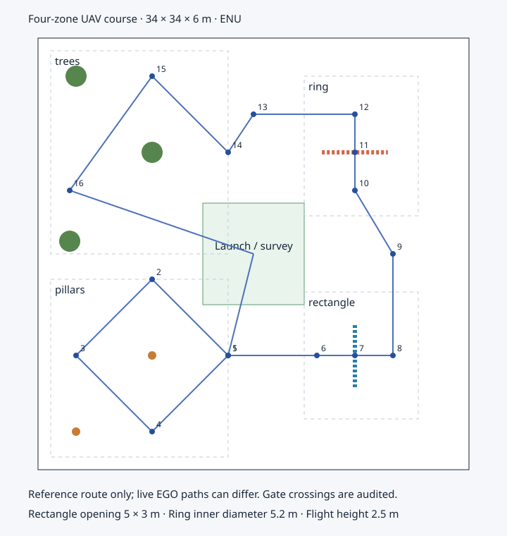

# 四区无人机障碍赛道

本赛道基于项目已有 `uav_obstacle_course.sdf` 扩展，供绕柱、穿矩形框、穿圆环及绕树测试。场地为 **34×34×6 米**，中央保留无障碍起降／观察区；场景、任务与验收使用同一份[几何配置](../../simulation/scenes/obstacle_course.json)。



图中路线是用于静态净空检查的参考折线，实际轨迹由 EGO 根据深度地图规划。矩形框和圆环在俯视图中以虚线表示开口所在平面。

| 区域 | 障碍与任务 | 配方 |
| --- | --- | --- |
| 西南：绕柱 | 两根直径 0.5 米、高 5.5 米的圆柱；围绕主柱按东→北→西→南→东经过检查点 | [course_pillars.json](../../simulation/missions/course_pillars.json) |
| 东南：矩形框 | 净开口 5×3 米，中心 `[8,-8,2.5]`；从西向东穿过 | [course_rectangle.json](../../simulation/missions/course_rectangle.json) |
| 东北：圆环 | 内径 5.2 米，中心 `[8,8,2.5]`；从南向北穿过 | [course_ring.json](../../simulation/missions/course_ring.json) |
| 西北：树木 | 三棵含树干、枝条和树冠碰撞的简化树木；经过东、北、西侧检查点 | [course_trees.json](../../simulation/missions/course_trees.json) |
| 完整任务 | 起飞→观察→绕柱→矩形框→圆环→树木→返航→降落，共 20 步 | [course_all.json](../../simulation/missions/course_all.json) |

圆环采用 32 个有真实碰撞的短节段，环内部保持空心。树冠为静态球体，枝条为圆柱；这是几何避障测试，不包含柔性枝叶、风场或动态树木。围墙与顶棚都有碰撞，柱高用于避免从柱顶直接抄近路。

## 构建和选择任务

在项目根目录运行。新增任务需要重新构建 mission/BT 包，后者为这一场景增加了独立的 1800 秒任务上限；原仓库任务保持原上限。

```bash
./scripts/build/build_px4_flight.sh --packages-select uav_mission uav_bt

# 只预览命令，不启动进程
./scripts/sim.sh run full --course all --dry-run

# 四区串联；默认实体 HID，不自动解锁或起飞
./scripts/sim.sh run full --course all

# 独立测试区：四者任选其一
./scripts/sim.sh run full --course pillars
./scripts/sim.sh run full --course rectangle
./scripts/sim.sh run full --course ring
./scripts/sim.sh run full --course trees

# 显式使用模拟遥控器
./scripts/sim.sh run full --course all --input-source virtual
```

省略 `--course` 保留原仓库及原任务。赛道通过同一个 `run full` 入口运行实际 PX4 动力学、cuVSLAM、MTF、深度建图、EGO 和 BT；不使用场景预览机型替代 PX4。赛道不能与仓库人体场景 `--person-scene` 叠加。

如果旧版本在启动时报告 `VIO primary MTF requires the fixed owned avoidance experiment`，原因是飞控网关的 VIO-primary 配置检查遗漏了赛道。修复后分别核对原仓库和赛道的区域／配置身份；仍要求受管仿真、实际 VIO 和资产摘要，禁止运行中切换融合源。更新代码后执行上面的 `uav_mission` 构建命令再启动；不要修改赛道配置身份或关闭 VIO 来绕过该检查。

定位预检等待期间也可执行 `./scripts/sim.sh stop`：收到当前会话的新鲜落地上锁状态后，运行器退出等待并清理；提前关闭不会计为定位／任务准入成功。

赛道地板显式设置白色环境光／漫反射材质，让近处地面纹理实际进入双目图像；旧材质会使画面下半部呈黑色，静止时出现明显估计漂移。VIO 仿真世界的重力统一为 9.81 m/s²，与 SDK 惯性模型一致，不修改传感器测量。启动使用连续 30 秒实测稳定窗口，门槛和证据文件见[启动说明](LAUNCHERS.md#全局无-gnss-策略)。静止优化的复测不替代动态飞行与全赛道验收。

## 运行前的地图与起点要求

1. 等待当前会话的 VIO／PX4 地面稳定及地图准入，检查 QGC 输入、源状态和地图。启动漂移期间仍不转发深度；本功能没有放宽定位或解锁门槛。
2. **先按现有手动操作流程观察、建图，再回到中央起点落地上锁。** 赛道范围大于相机单次可见范围，初始的中央 `OBSERVE` 只负责起点周围，不保证远端检查点、返航通道或门框背面已经观察。所有待飞路线及制动包络都需要地图支持；缺图时规划会拒绝，不会把真值几何预填成自由空间。操作与开关说明见[控制手册](SIMULATION_CONTROL.md)及[Pocket 操作说明](../flight/VIO_POCKET_AVOIDANCE.md)。
3. 任务仍通过现有遥控器 PREPARE／RUN 流程启动。起点水平位置须在当前局部 ENU 原点 0.3 米内；配方中的所有 `offset_enu` 都相对于本次任务起点，不是上一航点。启动新会话后须重新建图和准备任务。
4. 首轮逐区测试，核对各区验收结果后再运行 `all`。矩形框与圆环配方含入口、中心、出口及离开障碍区域的连接点，独立任务另有返航连接点。

当前安全配置继续采用机体半径 0.5 米、跟踪余量 0.3 米和水平制动余量 1.2 米；参考路线静态校验额外保留 0.2 米体素余量。此前 2.5～3 米开口的估算仅考虑了机体和跟踪余量，不适合现有水平制动包络。因此首版使用更大的开口，没有降低余量。完整参考折线约 122 米，这不是实测飞行距离或时间。

## 结果判定

操作会话中的 `course_truth` 进程只读取原生 Gazebo `/world/default/pose/info`，不发布 TF、定位或飞控指令。任务根节点结束后写入当前运行目录：

- `course-truth.jsonl`：约 20 Hz 的原始仿真时间／单调接收时间和机体真值位置。
- `course-flight.json`：当前运行身份、任务窗口、原点、任务结果及最终落地上锁状态。
- `course-assessment.json`：按序到点、正向穿越有效开口、连续轨迹机体净空、数据完整性和真实任务完成条件。

验收使用 TAKEOFF 到根任务结束的窗口；任务开始前的手动穿越不能满足任务要求。缺失轨迹、时间跳变、位置突变、绕到开口外侧、穿越反向或提前结束均不能通过。审计检查实际轨迹线段而非只检查最终航点；所有 NAVIGATE 检查点均须按序到达。实际轨迹碰撞校验包含机体和跟踪包络；运行中的地图准入另外检查水平制动包络。

`operator_session_passed` 仅说明完整项目操作会话正常关闭；BT 成功也不能单独证明赛道通过，须查看 `course-assessment.json`。可以离线复核已有证据：

```bash
./scripts/with_venv.sh python scripts/simulation/vio/analysis/assess_obstacle_course.py .cache/simulation/vio-sensors/<运行目录>
```

此处使用已知障碍位置和任务点测试建图、规划与控制。自动识别矩形框／圆环并估计其位姿尚未实现；人员感知模块不承担此功能。

## 修改场景与离线检查

修改几何配置后，同时重新生成原生 SDF、五套任务和俯视图，避免不同资产之间漂移：

```bash
PYTHONPATH=scripts python3 -m simulation.vio.runtime.obstacle_course --write
PYTHONPATH=scripts python3 -m simulation.vio.runtime.obstacle_course
PYTEST_DISABLE_PLUGIN_AUTOLOAD=1 ./scripts/with_venv.sh python -m pytest -q scripts/tests/test_obstacle_course.py
```

直接打开[原生 SDF](../../src/uav_bringup/gazebo/worlds/uav_obstacle_course.sdf)可预览无纹理几何与旧算法机型；完整项目在受管 PX4 世界中注入同源障碍，生成确定性的地面／障碍纹理并保留原有传感器标定。场景预览不启动 PX4/VIO/EGO 全链路。

已验证几何、配方、入口与审计回归，以及构建／Gazebo 场景加载；2026-10-29 另完成 all 赛道地面静止漂移优化及两次启动准入，见[对照记录](../validation/simulation/2026-10-29-vio-course-startup/REPORT.md)。动态定位、全程地图覆盖、穿越精度、全程自动任务与硬件飞行仍需后续验收。
